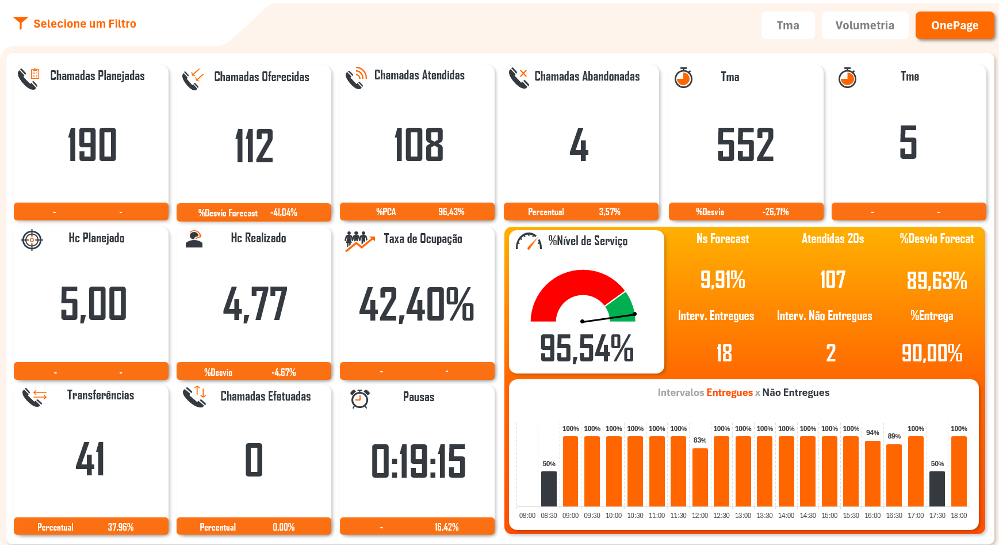
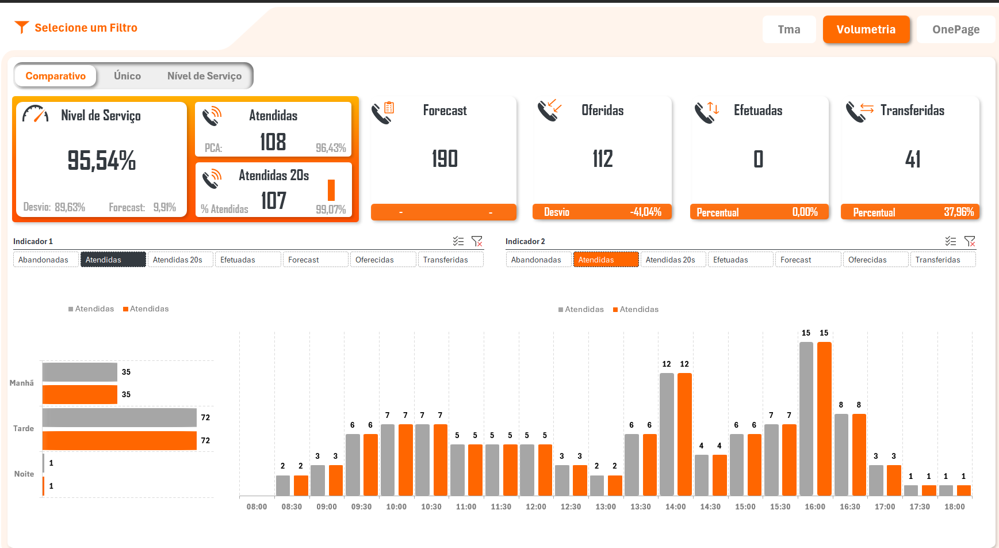
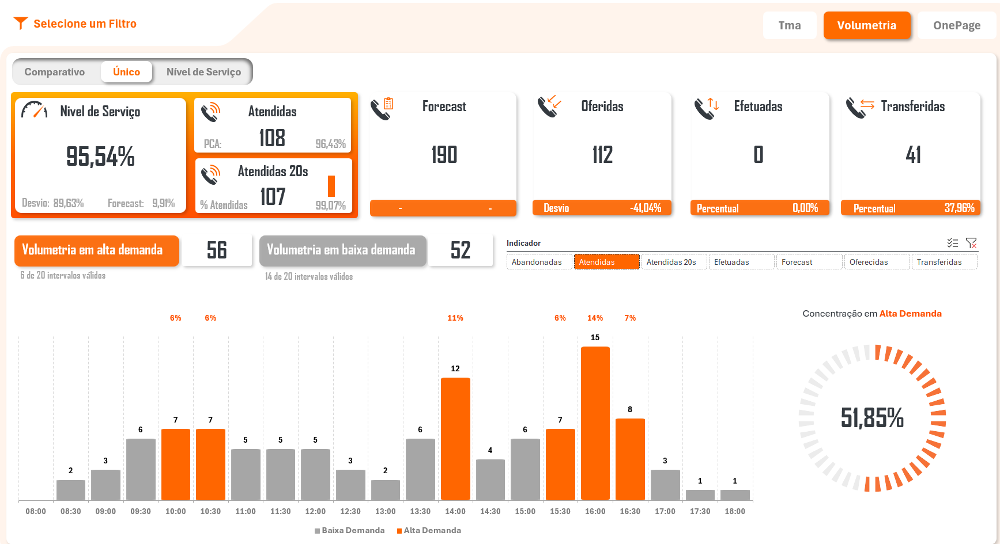
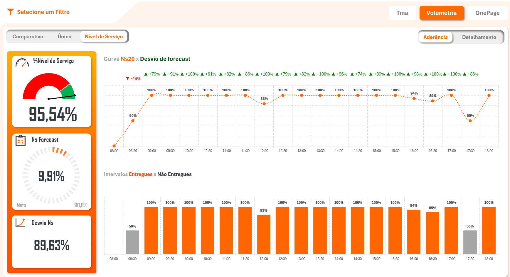
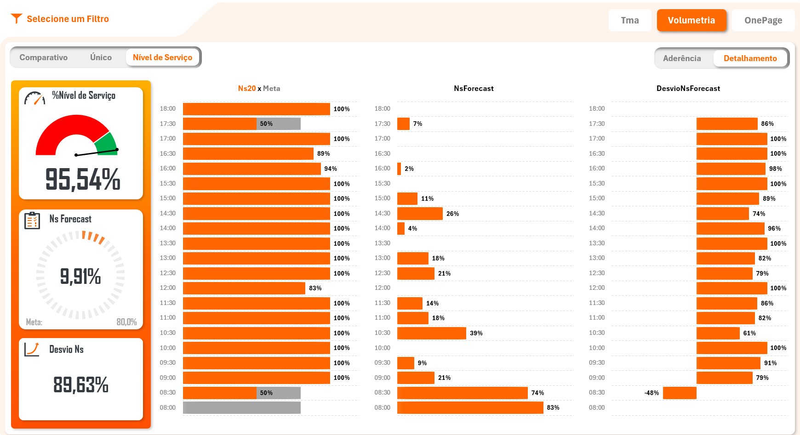
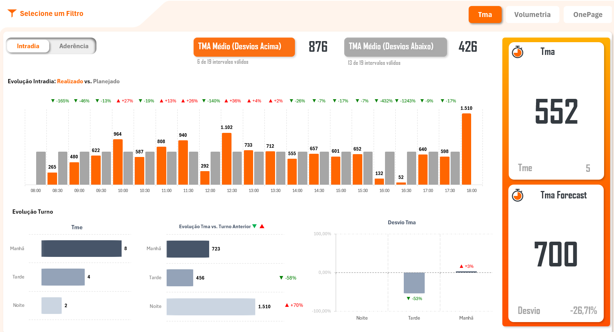
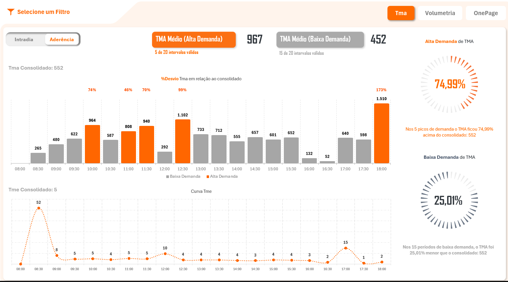
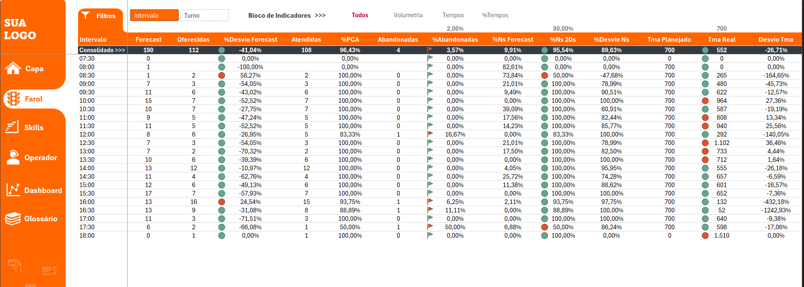
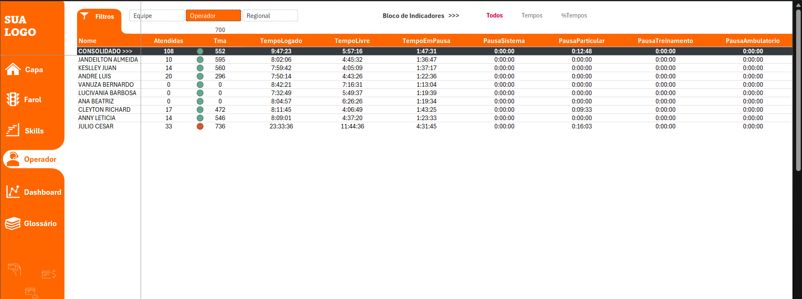

# 🚦 Farol Hora a Hora | Dashboard & Analytics Intraday

[](#)
[](#)
[](#)
[](#)

O **Farol Hora a Hora** é um ecossistema de relatórios tático-operacionais desenvolvido em Excel com automação robusta em VBA e consultas SQL otimizadas. Atualizado em ciclos rigorosos de **30 minutos**, o sistema consolida indicadores intraday essenciais para a tomada de decisão rápida e controle de operação.

---

## 🖼️ Visão Geral


---
## 📊 Painéis Executivos & Dashboards

### 1. Dashboard OnePage
Centralizador executivo com visão macro integrada da operação, ideal para tomadores de decisão que precisam de um diagnóstico rápido da operação em uma única tela.



- **Pontos Altos:**
  - **KPIs de Alto Impacto:** Painel com cartões consolidados de volumetria (*Planejadas, Oferecidas, Atendidas, Abandonadas*), tempos (*TMA e TME*), dimensionamento (*HC Planejado vs Realizado*, *Taxa de Ocupação*) e controle de pausas.
  - **Gauge Dinâmico de SLA:** Medidor visual de Nível de Serviço (%NS) integrado ao acompanhamento de aderência dos intervalos do dia (*Entregues vs Não Entregues*).

---

### 2. Dashboard Volumetria (Visão Comparativa)
Ferramenta desenvolvida para análise cruzada de dois indicadores volumétricos simultâneos ao longo dos intervalos do dia.



- **Pontos Altos:**
  - **Análise Bi-Paramétrica:** Permite selecionar e comparar dois indicadores no mesmo gráfico intraday (ex: *Atendidas* vs *Atendidas em até 20s* ou *Oferecidas* vs *Abandonadas*).
  - **Visão por Turno:** Consolidação dos volumes dividida entre os turnos *Manhã*, *Tarde* e *Noite* para rápida identificação de sazonalidades operacionais.

---

### 3. Dashboard Volumetria (Visão Única)
Focado na análise de curva de tráfego e segmentação por intensidade de demanda da operação.



- **Pontos Altos:**
  - **Classificação de Demanda:** Separação automática entre intervalos de *Alta Demanda* e *Baixa Demanda*, destacando picos operacionais em cores contrastantes.
  - **Métrica de Concentração:** Gráfico radial em rosca calculando o percentual exato da volumetria retida nos horários de maior pico.

---

### 4. Dashboard Nível de Serviço (Aderência Intraday)
Monitoramento em tempo real do cumprimento da meta de SLA por janela de atendimento de 30 minutos.



- **Pontos Altos:**
  - **Curva Ns20 vs Desvio de Forecast:** Linha de tendência indicando o percentual de atingimento do SLA e variação em relação ao planejado por intervalo.
  - **Status de Entrega por Intervalo:** Visualização em colunas categorizando os intervalos que atingiram o SLA (laranja) e os que ficaram abaixo da meta (cinza).

---

### 5. Dashboard Nível de Serviço (Detalhamento)
Visão analítica horizontal orientada à auditoria cirúrgica de horários de pico e falhas de cobertura.



- **Pontos Altos:**
  - **Triangulação de Indicadores:** Barras horizontais alinhadas comparando simultaneamente `%NS20 x Meta`, `NS Forecast` e o `Desvio de NS`.
  - **Auditoria Rápida:** Diagnóstico imediato das janelas horárias que puxaram o indicador consolidado de SLA para baixo.

---

### 6. Dashboard TMA (Visão Intradia)
Análise detalhada do Tempo Médio de Atendimento e Espera comparada às metas estabelecidas.



- **Pontos Altos:**
  - **Mapeamento de Desvios Extremos:** Destaque gráfico dos intervalos com *Desvios Acima* e *Desvios Abaixo* em relação ao parâmetro do dia.
  - **Análise Comparativa por Turno:** Avaliação da evolução do TMA em relação ao turno anterior e ao valor orçado em forecast.

---

### 7. Dashboard TMA (Aderência à Demanda)
Estudo de correlação entre o tempo de atendimento e o volume de tráfego da operação.



- **Pontos Altos:**
  - **Impacto da Demanda no TMA:** Demonstração visual de como o TMA se comporta nos picos de chamada (*Alta Demanda*) versus momentos de calmaria (*Baixa Demanda*).
  - **Curva Sincronizada de TME:** Acompanhamento do Tempo Médio de Espera na parte inferior, permitindo avaliar se a alta no TMA represou a fila de atendimento.
---

## 🔍 Visões Analíticas (Tabelas Dinâmicas Automatizadas via VBA)

As camadas analíticas do relatório utilizam Tabelas Dinâmicas controladas via VBA para permitir detalhamentos granulares sem perda de performance:

### 1. Visão Analítica Geral
Análise agregada dos principais indicadores do dia contra a meta informada.


### 2. Visão Analítica por Operador
Acompanhamento tático individualizado de produtividade e aderência da equipe.


---

## 💻 Arquitetura & Módulos VBA

O código-fonte em VBA foi desacoplado numa estrutura de camadas para garantir modularidade, desacoplamento de interface e facilidade de manutenção:

### 🎨 UserForms (`src/vba/forms/`)
Interfaces gráficas customizadas para suporte operacional e consulta de dicionário de dados:

| Componente | Tipo | Descrição / Responsabilidade |
| :--- | :--- | :--- |
| **`FrmGlossarioCompletoLight`** | Form | Modal principal para exibição e busca interativa do glossário completo de indicadores. |
| **`FrmGlossarioDetalheLight`** | Form | Tela detalhada (*popup*) que exibe a fórmula, conceito e regras de negócio de uma métrica selecionada. |

### ⚙️ Módulos Padrão (`src/vba/modules/`)
Core de processamento, atualização automatizada e manipulação de dados:

| Módulo | Tipo | Descrição / Responsabilidade |
| :--- | :--- | :--- |
| **`Program.bas`** | Módulo | **Entry Point** da aplicação. Orquestra o fluxo principal de execução e conexão SQL. |
| **`Dashboard_.bas`** | Módulo | Manipulação programática dos shapes, graficos, otimização de PivotCaches e renderização. |
| **`ConfigPlanilha.bas`** | Módulo | Rotinas de infraestrutura: toggles de performance (`ScreenUpdating`, `DisplayFullScreen`). |
| **`RegistroLog.bas`** | Módulo | Rastreabilidade: grava logs de execução, horários de atualização e captura de exceções. |
| **`FrmGlossarioConfiguracoes.bas`** | Módulo | Camada de serviço para os Forms de glossário, filtrando parâmetros em memória. |

### 📦 Objetos & Eventos (`src/vba/objects/`)
Manipulação de eventos de interface e escopo das planilhas (`Worksheets` / `Workbook`):

| Objeto | Classe | Descrição / Responsabilidade |
| :--- | :--- | :--- |
| **`EstaPastaDeTrabalho`** | Workbook | Trata eventos globais do arquivo (`Workbook_Open`, `Workbook_BeforeClose`) e inicialização. |
| **`Capa`** | Sheet | Gerencia interações, menus de atalho e ações de navegação da aba inicial. |
| **`ConfigMenu`** | Sheet | Controla os gatilhos visuais e eventos de clique da aba de configurações e filtros. |
| **`Dashboard`** | Sheet | Captura eventos da planilha de Dashboards para alternância dinâmica de telas. |
| **`Farol`** | Sheet | Lógica de interatividade e eventos da aba principal do Farol de indicadores intraday. |
| **`Operador`** | Sheet | Eventos e atualizações específicas da aba de visão analítica por operador. |

---

## 🎯 Métricas & Indicadores Monitorados

| Indicador | Sigla / Métrica | Descrição |
| :--- | :--- | :--- |
| **Forecast** | Previsão | Volume previsto de contatos/chamadas projetado para o intervalo. |
| **Volumetria** | Realizado | Volume efetivamente recebido, atendido e retido no período. |
| **Tempos de Atendimento** | TMA / TME | Tempo Médio de Atendimento e Tempo Médio de Espera. |
| **Nível de Serviço** | NS (%) | Percentual de chamadas atendidas dentro do SLA pré-estabelecido. |

---

## 📂 Arquitetura do Repositório

Organização estrutural projetada para controle de versão granular e separação de responsabilidades:

```text
farol-hora-hora/
├── assests/
│   └── img/                    # Capturas de tela e assets visuais da documentação
│       ├── analitico-operador.png
│       ├── analitico-skills.png
│       ├── analitico.png
│       ├── capa.png
│       └── dashboard-onepage.png
├── dist/
│   └── Farol.xlsb              # Arquivo executável da operação (Formato Binário)
├── docs/                       # Documentação técnica e operacional estendida
└── src/
    ├── sql/                    # Scripts SQL para staging e carga de dados
    └── vba/                    # Código-fonte VBA extraído e versionado
        ├── forms/      # UserForms (.frm) para interfaces dinâmicas de usuário
        ├── modules/    # Módulos Padrão (.bas) com a lógica de negócio e orquestração
        └── objects/    # Módulos de Objeto (.cls) associados a Worksheets e Workbook